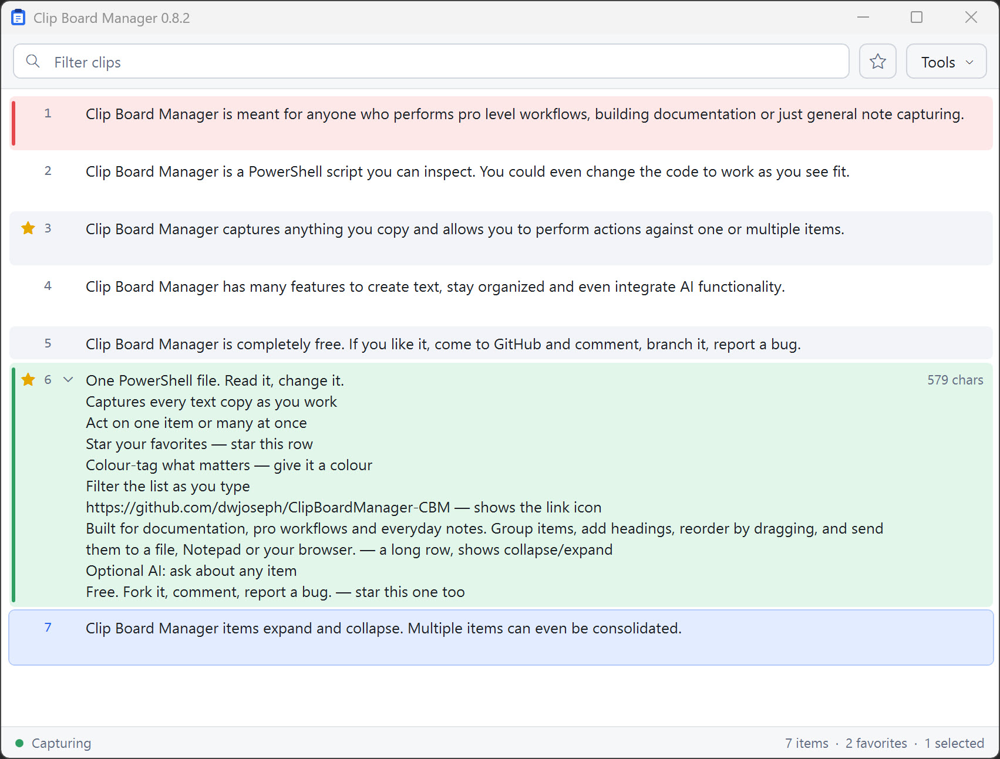
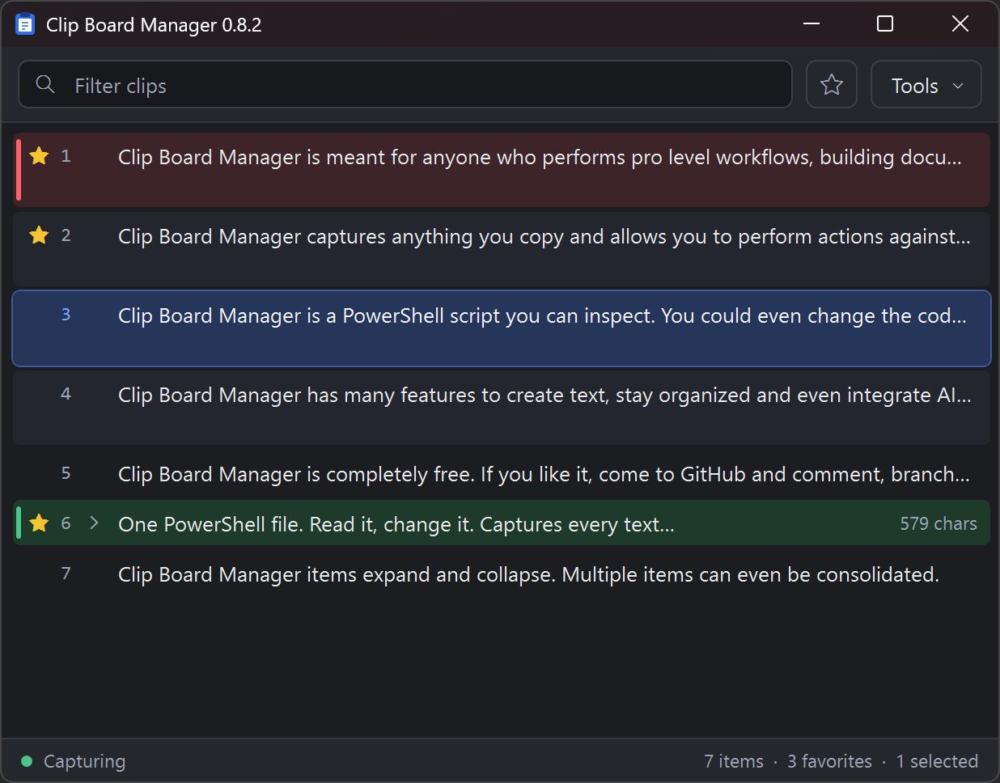
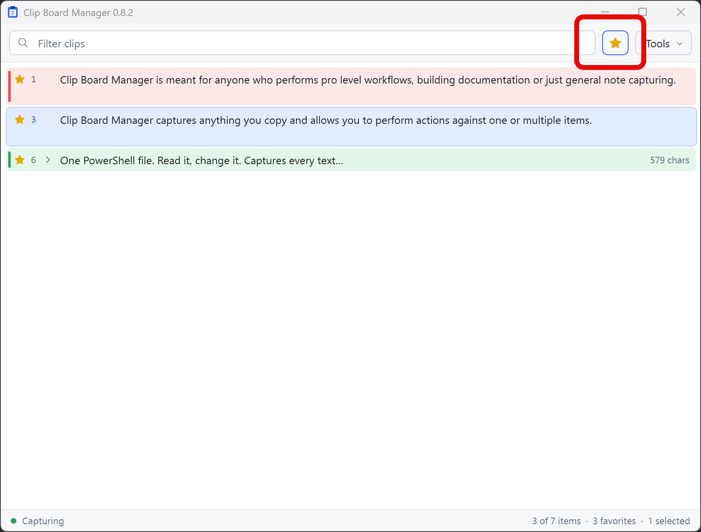
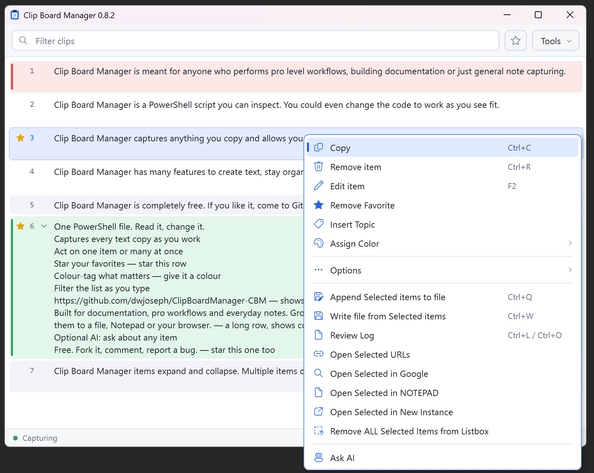
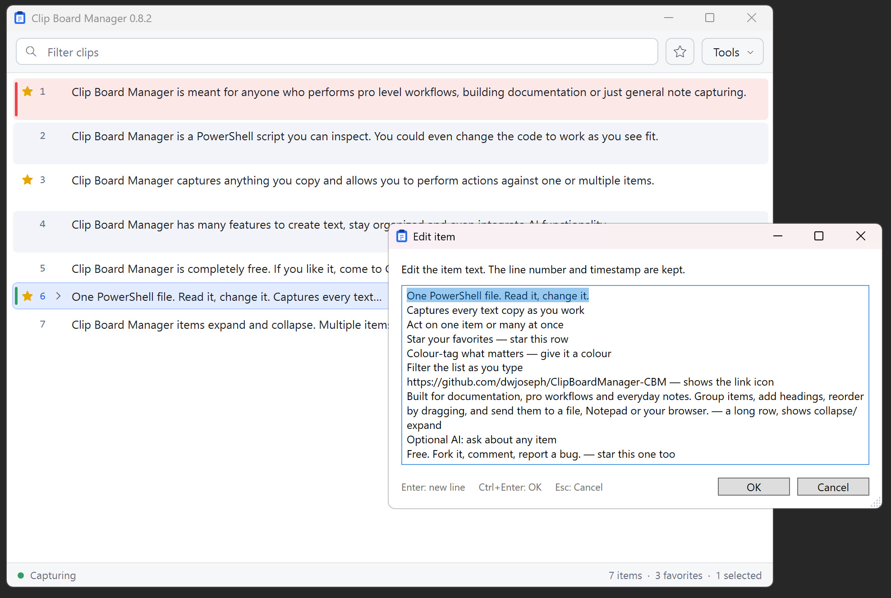
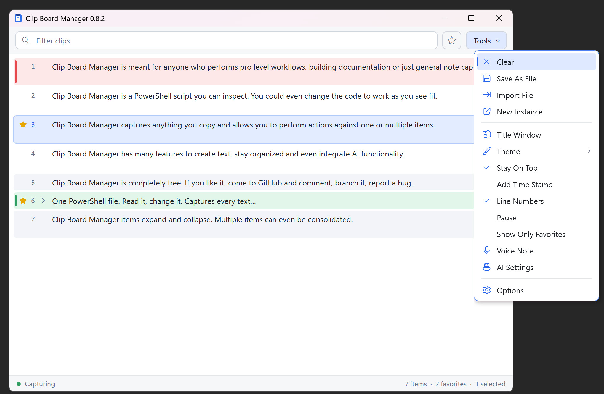
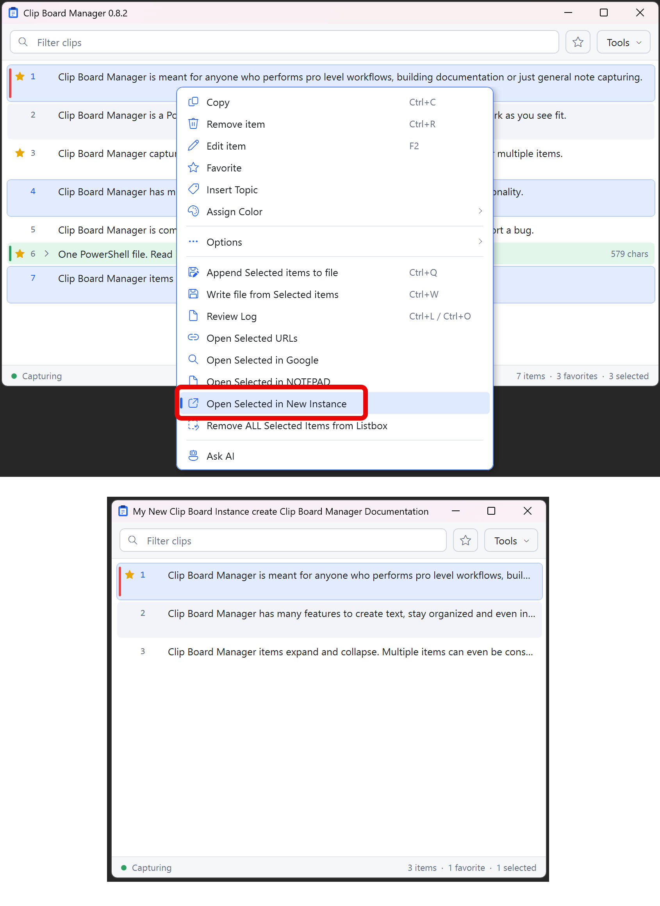
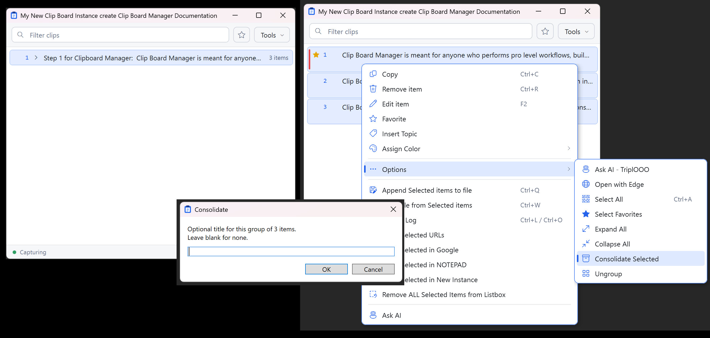
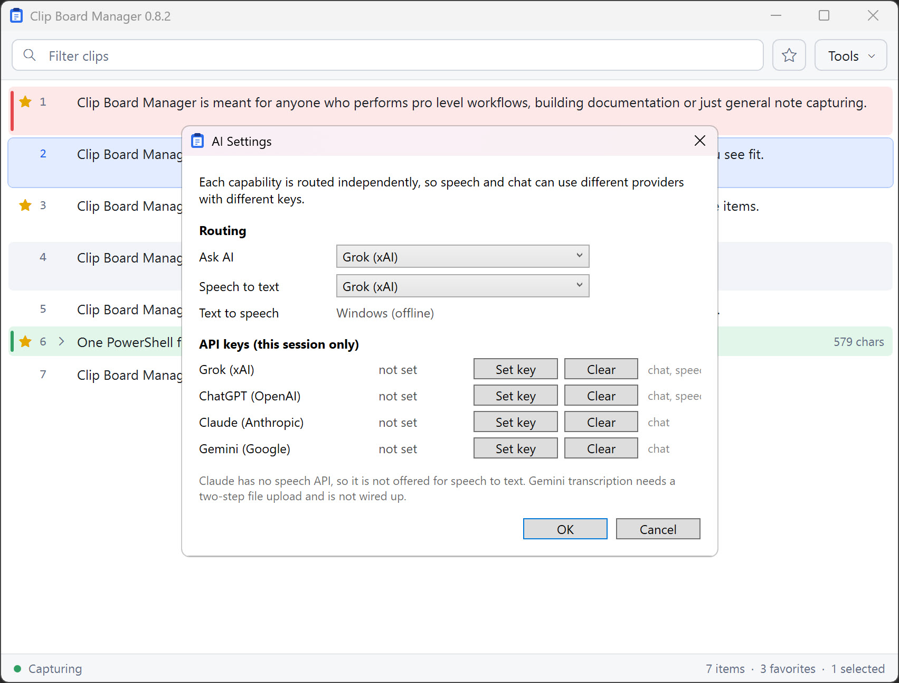

# ClipBoardManager-CBM

**[Download ClipBoardManager-CBM-0.8.3.zip](https://github.com/dwjoseph/ClipBoardManager-CBM/releases/download/v0.8.3/ClipBoardManager-CBM-0.8.3.zip)** -
extract it, then double-click `Start-ClipBoardManager.vbs`.

A clipboard history window for Windows, in one PowerShell file. Everything you copy
is listed; filter it, star it, colour it, group it, and send it to a file, Notepad,
your browser or an AI provider.

No install, no extra modules, and nothing saved to disk unless you ask for it.



> Disclaimer: I am not a PowerShell developer, just a home hobbyist. I found this
> tool many years ago and kept adding to it. It works well for my needs and I hope
> it helps you too.

## Get started

1. Download `ClipBoardManager-CBM-0.8.3.zip` with the link at the top of this page.
   It is also in the file list above and on the [Releases](../../releases) page.
2. Extract it, and keep the files together in one folder.
3. Double-click **`Start-ClipBoardManager.vbs`**.

> **Which file do I run?** `Start-ClipBoardManager.vbs`. It starts the `.ps1` file
> sitting beside it, with no console window. Do not double-click the `.ps1` itself:
> Windows opens it in Notepad instead of running it.

The launcher and the `.ps1` must stay in the same folder. If you add a newer `.ps1`
to that folder later, the launcher starts the highest version it finds.

To start it when you sign in, put a shortcut to the `.vbs` file in `shell:startup`.

The launcher is a convenience. You can also run the script directly from a command line:

```powershell
powershell -ExecutionPolicy Bypass -File .\ClipBoardManager-CBM-0.8.3.ps1
```

The window opens in the light theme. Change it at any time under Tools > Theme
(Light, Dark, or Follow Windows). To start in another theme, add `-Theme Dark` or
`-Theme Auto` to the command.

**Needs:** Windows 10 or 11 with Windows PowerShell 5.1 (already part of Windows).

If Windows shows a security prompt, right-click the downloaded zip, choose
Properties, tick Unblock, and extract it again.

## What it does

| | |
|---|---|
| **History** | Captures every text copy, numbered, with an optional time stamp. Pause when you do not want capture. |
| **Filter** | Type in the filter box to narrow the list as you type. |
| **Favorites** | Click the star in front of a row. Show only favorites with one click. |
| **Quick actions** | Point at a row for Copy, Favorite and Remove icons that act on that one row. |
| **Colours and topics** | Tag rows red, green, yellow or blue. Insert Topic rows as headings. |
| **Edit** | F2 opens a multi-line editor for the selected item. |
| **Long items** | Long text collapses to one line with its length in a small badge. Right / Left arrows expand and collapse. |
| **Groups** | Consolidate several items into one collapsible group. Ungroup brings them back. |
| **Reorder** | Drag a single selected item to a new position. |
| **Send it somewhere** | Save or append to a file, add to a Review Log, open in Notepad, Edge, Google, or as URLs. |
| **More windows** | Start a new instance, or open the selected items in a new instance. |
| **Look** | Light and dark themes you can switch while it runs, a stay-on-top option, and your own window title. |
| **AI (optional)** | Ask AI about selected items, and dictate a Voice Note. |



The pictures on this page were taken with 0.8.2. In 0.8.3 the alternating rows are
easier to tell apart, lengths show as a badge, and the row under the pointer shows
the quick-action icons.

### Favorites

Click the star in front of any row, or right-click and choose Favorite for all
selected rows. The star button beside the filter box shows only favorites.

Favorites are written with `* ` in front of the text when you save, append, log or
open items in Notepad or Edge. A plain Copy stays clean.



### Right-click menu



### Edit item

Enter starts a new line, Ctrl+Enter saves, Esc cancels.



### Tools menu

Clear, save and import the list, start a new instance, rename the window, switch
theme, and turn the switches on and off.



### Open Selected in New Instance

Select the items you want and send them to a second, independent window. The new
window keeps their stars and colours, and the main window carries on capturing.



### Consolidate

Select several items, then right-click > Options > Consolidate Selected to merge
them into one collapsible group with an optional title. Ungroup brings them back.



## Keyboard shortcuts

| Key | Action |
|---|---|
| F2 | Edit the selected item |
| Right / Left | Expand / collapse the selected items |
| Ctrl + A | Select all |
| Ctrl + C | Copy selected items |
| Ctrl + R | Remove selected items |
| Ctrl + W | Write selected items to a new file |
| Ctrl + Q | Append selected items to an existing file |
| Ctrl + L | Append selected items to the Review Log |
| Ctrl + O | Open the Review Log |
| Ctrl + E | Exit |

## Privacy

- The history, favorites, colours and settings live in memory only. Close the
  window and they are gone.
- The only file the tool keeps is the Review Log, and only when you add to it:
  `Documents\ClipBoardManager-CBM-ReviewLog.txt`.
- Open Selected in New Instance and Open with Edge use a temporary file in `%TEMP%`.

## AI features (optional)

Ask AI and Voice Note are off until you use them, and they need **your own API key**.

- Providers: Grok (xAI), ChatGPT (OpenAI), Claude (Anthropic), Gemini (Google).
  Pick one per task under Tools > AI Settings.
- Voice Note speech-to-text works with Grok and OpenAI.
- Keys are asked for when needed and held in memory only. They are never written to
  disk, so you re-enter them after a restart.
- These features send the selected text, or your recording, to the provider you
  chose. Nothing else in the tool leaves your PC.



## Known issues

- After the window is closed, a hidden `powershell.exe` can stay running. End it in
  Task Manager if needed.
- "Remove ALL Selected Items from Listbox" does not remove anything yet.
- Cancel on Ctrl + L still writes to the Review Log.
- Import File does not turn a leading `* ` back into a favorite.

## Credits

- Boe Prox - original clipboard history viewer (2014)
- ChrisDee - script collection on GitHub (2016)
- Duane Joseph - feature development (2023 onward)

The full version history is in the comment block at the top of the script.
